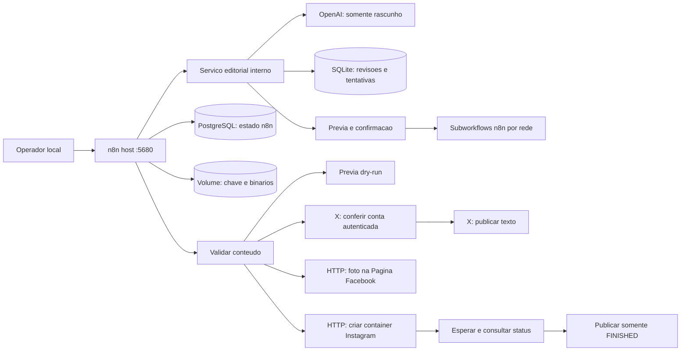

# Arquitetura

## Implementado

Um processo n8n em modo regular atende o inicio do projeto. Banco sem porta publicada; editor ligado exclusivamente a 127.0.0.1. Docker oferece a rede interna padrao. A saida para APIs externas permanece disponivel. Volumes persistem entre reinicios. Fuso: America/Cuiaba.

PostgreSQL guarda o estado interno do n8n; o volume n8n_data guarda configuracao e binarios. A chave N8N_ENCRYPTION_KEY vem do `.env` e deve acompanhar todos os backups. A versao n8n e fixada em 2.47.3; PostgreSQL usa a linha 17-alpine, que recebe atualizacoes. Para builds integralmente reproduziveis, fixe tambem digests apos validar as imagens.

Os templates usam Manual Trigger e HTTP Request com header Authorization resolvido por referencia `$env`; IDs, versao Graph e tokens sao configurados exclusivamente no `.env`. Nao ha cron, webhook publico nem agente de IA publicando. A imagem precisa estar acessivel por HTTPS para a Meta; o Docker nao a hospeda. Os templates manuais atendem foto individual. Pelo chatbot, anexos Instagram atendem foto, Reel e carrossel; stories e formatos adicionais continuam fora do escopo.

## Contrato editorial futuro

Cada publicacao deve conter `content_id`, `revision`, `caption`, `media[]` (URL, tipo MIME, direitos), `destinations[]` (plataforma/conta), `scheduled_at` em ISO-8601 com offset, `approval` (revisor, data, revisao aprovada) e `dry_run`. O modelo manual atual usa apenas os campos expostos no node Conteudo; esse contrato completo ainda nao e aceito por uma API.

Modelo proposto para fila: `draft -> approved -> scheduled -> publishing -> published | failed | unknown`. Uma alteracao de texto, midia ou destino invalida a aprovacao da revisao anterior. Cada destino tem estado e ID remoto independentes; sucesso Facebook nao implica sucesso Instagram.

A proxima etapa cria banco e usuario editoriais separados, com chave unica `(content_id, revision, platform, account_id)`, transicao atomica para `publishing`, lease para concorrencia e registro dos IDs de container/publicacao. A exclusao mutua evita duas execucoes locais simultaneas; um timeout remoto ainda exige reconciliacao. Nunca prometer exactly-once apenas com uma chave no banco local.

## Etapas seguintes

1. Conectar contas de teste Meta e validar foto real autorizada.
2. Implementar fila editorial, aprovacao persistente, auditoria, reconciliacao e agendamento.
3. Adicionar armazenamento HTTPS de midia, alertas e verificacao de expiracao dos tokens.
4. Implementar reels/carrosseis com polling limitado e tratamento de status.
5. Expandir X para midias e renovacao OAuth; criar adaptadores YouTube e TikTok, verificando acesso, custos, OAuth, revisao de app e limites nas fontes oficiais de cada plataforma.
6. Quando volume exigir, avaliar queue mode + Redis + workers, binarios compartilhados compativeis e recursos/licenca aplicaveis.

Redis, proxy HTTPS e armazenamento de objetos nao sao necessarios ao teste manual local e nao estao incluidos nesta entrega.

## Adaptador X

`x-check-account.json` verifica identidade sem escrever; `x-text.json` confere a conta antes de publicar texto. Configuracao exclusiva por `X_USER_ID` e `X_OAUTH2_ACCESS_TOKEN` no `.env`. O POST nao recebe retry. Detalhes, escopos e limites em `docs/x-setup.md`. OAuth automatico e midias ainda nao estao implementados; os modelos usam um token de usuario existente.

## Chatbot implementado

O servico editorial e um processo Python separado, sem porta no host e sem tokens sociais. Usa OpenAI Responses API com Structured Outputs para propor um rascunho. SQLite em volume proprio guarda sessao/revisao, confirmacao com validade e tentativas por destino. O chatbot n8n chama subworkflows derivados dos publicadores existentes e espera seus retornos. Os tres subworkflows sao publicados apenas para chamadas internas; o chat permanece privado/inativo ate configuracao. Esse registro e implementado para envios iniciados pelo chatbot; a fila editorial agendada e a reconciliacao automatica continuam futuras. Detalhes em `docs/chatbot.md`.

## Subagente de imagem

O workflow dedicado recebe descricao e devolve JPEG em binary.data. A implementacao de API fica em `services/editorial/image_agent.py`, isolada das funcoes de redacao/publicacao. Usa a mesma chave OpenAI do servico, modelo configuravel e registro persistente de tentativas. O chatbot o chama por comando explicito e invalida a previa; a imagem so entra no rascunho quando houver URL publica configurada. O arquivo interno persiste no volume editorial e entra no backup. Hospedagem HTTPS externa continua dependendo de dominio/proxy configurados pelo operador.

## Comentarios da comunidade

O servico `community` e separado do editorial, recebe somente credenciais sociais e configuracao do modulo e usa o volume `community_data`. Consulta posts recentes proprios, aplica skills JSON do Alpendre e guarda propostas, aprovacoes, opt-outs e tentativas em SQLite. O n8n agenda ou inicia ciclos e expoe helpers internos para classificar/aprovar. O modulo nao recebe chave OpenAI e nao exige liberar acesso a ambiente nos nodes. Leitura/envio comecam desligados. Adaptadores atuais: Instagram/Facebook/X, com X em revisao por padrao. Guia completo: `docs/comment-workflows.md`.

## Upload de midias implementado

O chatbot recebe anexos binarios e guarda-os no editorial_data. O painel local da mesma sessao permite upload multiplo, previa e ordenacao; importacao de caminhos fica limitada a uma biblioteca explicitamente montada em modo somente leitura. A IA recebe fotos para redacao, mas a selecao e a ordem sao controladas pelo servico editorial. Alterar midias invalida a confirmacao. O adaptador instagram-media, separado do modelo, implementa foto, Reel e carrossel com registro duravel de containers e bloqueio apos resultado incerto. media-public serve somente arquivos; HTTPS externo depende de proxy/tunel configurado. Facebook e X continuam com os formatos anteriores. Nenhuma agenda ou permissao de envio e habilitada pela instalacao.
